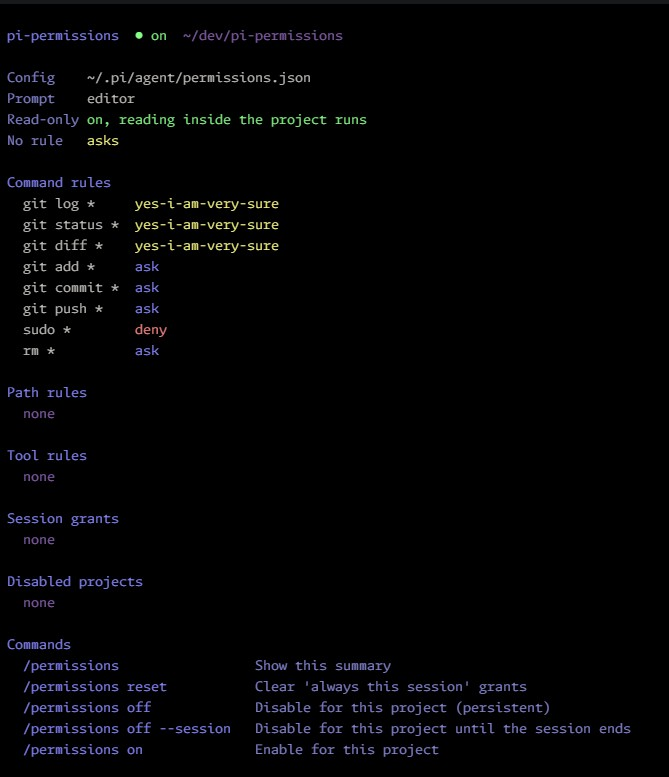

# pi-permissions

Permission prompts for [Pi](https://pi.dev), for the slightly paranoid.

Every tool call is checked against your rules before it runs: allowed calls run, denied calls are blocked, everything else asks.

**It observes and decides; it does not steer the agent.** Agents chain `cd`, pipes and inline scripts, and that is taken as a given: it changes no prompt, instruction or tool the agent sees. Its job is to let through what is safe and make what is not easy to judge.

## Install

```sh
pi install git:github.com/Ozmah/pi-permissions@v0.5.0
```

The `@v0.5.0` tag pins the version. Without it you get the latest commit of the default branch.

Create `~/.pi/agent/permissions.json` (start from [`permissions.example.json`](permissions.example.json)) and run `/reload`. Without it, every tool call asks.

## Usage

Run `/permissions` to see the active rules, session grants and available commands.



## Configuration

Rules list what must not happen. Anything without a rule asks, and a "stfu pi" grant silences those questions for a folder until the session ends.

```json
{
  "commands": {
    "sudo *": "halt",
    "git push --force *": "deny",
    "git add *": "ask",
    "git commit *": "ask",
    "git push *": "ask",
    "bun test *": "yes-i-am-very-sure"
  },
  "paths": {
    "~/.ssh/**": "deny",
    "**/.env": "ask",
    "~/dev/**": "yes-i-am-very-sure"
  },
  "tools": { "webfetch": "deny" },
  "readonly": true,
  "ui": { "position": "editor" }
}
```

| Key                    | Applies to                                                                                                |
| ---------------------- | --------------------------------------------------------------------------------------------------------- |
| `commands`             | Each segment of a bash command.                                                                           |
| `paths`                | Paths that any tool reads or writes: file tools, and the files read-only bash commands read.              |
| `tools`                | Tools by name: `read`, `write`, `edit`, `ls`, `find`, `grep`, MCP and extension tools.                    |
| `readonly`             | Reads inside the project run without asking, with file tools and read-only bash commands. Default `true`. |
| `ui.position`          | `editor` (replaces the input), `center` or `top`.                                                         |
| `ui.describe_commands` | Asks the agent to describe each bash command in a few words, shown in the prompt. Default `false`.        |

| Value                | Effect                                                                          | Skipped by stfu |
| -------------------- | ------------------------------------------------------------------------------- | --------------- |
| `halt`               | Blocks the call, alerts you, and tells the agent the config forbids it.         | No              |
| `deny`               | Blocks the call.                                                                | No              |
| `ask`                | Asks every time.                                                                | No              |
| `yes-i-am-very-sure` | Runs without asking. The value is long and odd so nobody writes it by accident. | n/a             |
| (no rule)            | Asks. Reads inside the project run when `readonly` is on.                       | Yes             |

`"allow"` is rejected with an error that points to `"yes-i-am-very-sure"`. A config that still uses the keys from before 0.5 (`default`, `external_directory`, `bash`, `readonly_commands`) gets an error, and those keys are ignored.

`~/.pi/agent/permissions.json` is global. `<project>/.pi/permissions.json` applies to that project, only if it is trusted, and overrides the global file key by key. Both are read on every call; no `/reload` needed.

### Patterns

`*` matches anything, including `/` and spaces, and `**` means the same. `?` matches one character. A trailing ` *`, `/*` or `/**` also matches the bare prefix: `git status *` matches `git status`, and `~/.ssh/**` matches `~/.ssh`. `~/` is the home directory. Path rules are checked against the real path and the requested one, so a symlink cannot get around either.

### Precedence

Every matching rule counts and the strictest one wins: `halt`, then `deny`, `ask` and `yes-i-am-very-sure`. With `"git *": "yes-i-am-very-sure"` and `"git push *": "ask"`, `git push` asks.

### Safety net

A `halt`, `deny` or `ask` command can show up somewhere other than the start of a segment: `$(sudo …)`, `bash -c "sudo …"`, `env sudo`, `/usr/bin/sudo`, or a line inside a script. When it does, the call asks and stfu does not skip it. The same applies to a strict path written in a command, such as `~/.ssh`, `$HOME/.ssh` or `.env`. These cases ask instead of blocking because the text may only mention the command, as in `grep sudo log`. Rules whose wildcard filters the arguments, like `cat *secret*`, are left out.

### Bash

Commands are split on `&&`, `||`, `|`, `;`, `&` and newlines, outside quotes, and every segment is checked. A `#` that starts a word comments out the rest of the line, as in bash: quotes, `<<` and operators in it do nothing. Command substitution, process substitution, redirection to a file and unclosed quotes always ask. A here-document body (`<<EOF`, `<<'EOF'`, `<<-EOF`) belongs to the command that opens it, and the prompt shows it as a block under that command. A substitution inside an unquoted here-document asks, and so does a missing delimiter.

Inline scripts (`python3 - <<'EOF'`, `python3 -c`, `node -e`, `bash -c`, `ruby -e`, `perl -e`, `php -r`) get a label and highlighting in their language. They are arbitrary code, so they always go through the command rules; the extension shows them and makes no attempt to interpret them.

The prompt lists first what needs a decision, then folds what is already allowed into one line.

### Read-only commands

With `readonly` on, a segment that only reads runs when every path it reads is inside the project or allowed by a path rule, so `cd apps/server && grep -n foo src/*.ts | head -20` runs without asking. Command rules still decide when they match, and path rules apply to what those commands read.

- Commands: `cat`, `head`, `tail`, `wc`, `ls`, `cut`, `grep`, `egrep`, `fgrep`, `rg`, `find`, `sort`, `uniq`, `echo`, `pwd`, `cd`.
- `sed` counts only as `sed -n` with a script that prints line ranges (`5p`, `1,60p`, `$p`, `10,$p`), given as the first operand or with `-e`. `-i`, `-f` and any other script ask: `w` writes, `e` runs commands and `r` reads other files.
- Flags that write, run programs or follow symlinks disqualify the segment: `find -exec/-delete/-fprint/-L`, `rg --pre/-L`, `grep -R`, `sort -o`, `tail -f`, `uniq in out`. Abbreviated long flags count as the flag they abbreviate (`sort --o=file` is `sort --output=file`), as GNU tools accept them. Output redirections other than `/dev/null` or an fd disqualify it too.
- Every operand is checked as a path, patterns included. `grep "/api" src` asks for `/api` when it is outside the project. A wrong guess can only add a prompt, and the reason marks an operand that is no file as "no such file, checked as a path". Input redirections (`< file`) are checked too, and a here-document or here-string feeding a read-only command is plain input.
- `cd` is followed: later relative paths are checked against every directory the command may be in. `cd -`, `cd $VAR`, `pushd`, `builtin`, `eval`, assignments, and `cd name` with `$CDPATH` set lose track, and later relative paths ask.
- Variables, `~user`, subshells, brace expansion and comments are not resolved, so the segment asks. A glob is checked by its fixed directory (`src/*.ts` → `src`). `..` after a wildcard asks, and so does a wildcard component that starts with a dot (`.*`, `.?`), which bash before 5.2 can expand to `..`.

### Command descriptions

With `"ui": { "describe_commands": true }`, the bash tool gets an optional `description` argument where the agent says what the command does, and the prompt shows it above the command as `Agent says: …`. It is the agent's claim, not something the extension checks: the command below it is what runs, and the decision ignores the description.

The extension replaces Pi's `bash` registration to add the argument, so it is off by default and read from the global config only. Another extension that also replaces `bash` conflicts with it, and Pi reports the conflict. Turning it on or off needs `/reload`.

### Protected files

Writing the permission files or the extension's own files always asks, whatever the rules, and no grant covers it. A bash command that mentions them asks too, unless every segment is a read-only command.

## Prompt

| Key                                       | Action                                                                         |
| ----------------------------------------- | ------------------------------------------------------------------------------ |
| `Enter`                                   | Selected option (`Yes` by default)                                             |
| `y` / `n`                                 | Yes / No                                                                       |
| `m`                                       | Yes, and add a message to the tool result (one line, `Esc` goes back)          |
| `t`                                       | No, and tell pi what to do instead (one line, `Esc` goes back)                 |
| `a` / `d`                                 | stfu pi on the folder / the folder and subfolders, for the rest of the session |
| `←` `→` `Tab`                             | Change selection (also `↑` `↓` when options are one per row)                   |
| Click an option                           | Select it; click it again to confirm (fullscreen mode only)                    |
| `↑` `↓` `PgUp` `PgDn` `Home` `End`, wheel | Scroll (`↑` `↓` select instead when options are one per row)                   |
| `Shift+↑` `Shift+↓`                       | Scroll, in any layout. In fullscreen Pi keeps `PgUp` `PgDn` for the transcript |
| `Esc`                                     | No                                                                             |

### stfu pi on a folder

`a` ("stfu pi on <folder>/") gives every tool, bash included, total access to the folder the call works in until the session ends. `d` ("…and subfolders") covers its subfolders too. For file tools the folder is the file's. For bash it is the folder the command runs in, following its `cd`s. No option is offered when that folder cannot be known, or when it is your home, a folder containing it (`/home`) or the root, where one stray keypress would silence everything. Tools without a path get `a` for any input.

Why folders and not commands: agents today send endless one-liners, chaining `cd`, pipes and inline scripts to do something complex in a single command (blame Opus 5.5 and Sol 6.1). An exact command never comes back twice, so "always this command" was useless. Trusting a folder is the decision that actually holds, for now at least.

In bash, total access allows any command that runs in the folder, whatever paths it touches. While a grant is active the status bar shows `🤫 stfu pi on <folder>/` (`/**` with subfolders), and `/permissions reset` clears every grant. `/permissions stfu` removes one: pick it from a list, or name its folder (`/permissions stfu ~/dev/app`, with completion). Grants live in memory and end with the session. They never cover protected files or `halt`, `deny` and `ask` rules. When an active grant touches a call but does not cover it, the prompt says why first, for example: `stfu pi on ~/dev/app/ → does not cover this call: ~/dev/app/src is in a subfolder, and [d] would include subfolders`.

## Turning it off

`/permissions off` disables the extension for the current working directory: tool calls run without checks, as in Pi without it. `/permissions off --session` lasts until the session ends. `/permissions on` re-enables it. The status bar shows `⚠ permissions off` while disabled.

## Limitations

- It is not a sandbox. It decides whether a call runs, not what the call can reach.
- A list of what must not happen is never complete. It works because anything without a rule asks: `halt` and `deny` catch what you listed, and everything else still reaches you.
- Bash can touch paths that cannot be detected from the command text, and the safety net only finds what is written plainly. A script can build `sudo` out of pieces.
- A trailing `*` allows any argument, and some commands write through options (`git log --output=<file>`). Keep that in mind when you use `yes-i-am-very-sure`.
- The bash scanner is not a full shell parser. When unsure, it asks.
- Read-only commands: a glob that matches a symlink inside the project can read where the symlink points.
- While disabled, the agent can write any file, including the permission files.

## Development

Requires Node.js 22.18 or later.

```sh
npm install
npm run check          # format, lint (incl. anti-slop), typecheck, tests
npm run format         # apply formatting
npm run lint -- --fix  # apply spacing fixes
pi -e ./               # try a local checkout without installing
```

## Contributing

Ok to use AI, just read your agent's crap and make sure it's good, or be forever banned if it looks vibed.

`npm run check` must pass.

## License

[MIT](LICENSE) © [Ozmah](https://ozmah.dev)
